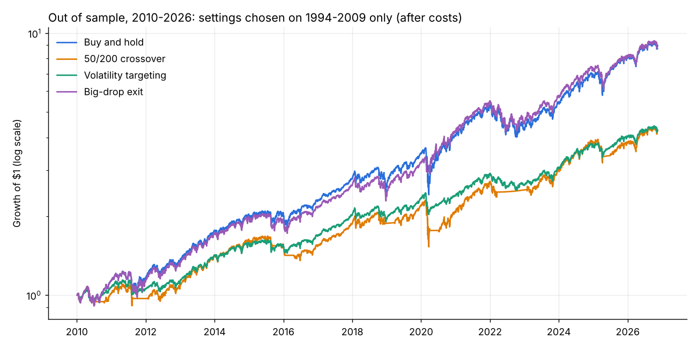

# Can a simple rule dodge crashes? SPY 1993-2026

_Generated by `scripts/crash_defence.py`. Data Jan 1993 to 13 Nov 2026. Costs 10 bps per unit traded; cash earns the 13-week T-bill rate; signals act from the next day. Explanation: [`docs/crash-defence.md`](../docs/crash-defence.md)._

## 1. The fair test: 2010-2026, with settings picked on 1994-2009

| Rule | CAGR | Sharpe | Worst fall | Avg invested | Trades / yr |
| --- | --- | --- | --- | --- | --- |
| Buy and hold | +14.0% | 0.85 | -34% | 100% | 0.0 |
| 50/200 crossover | +9.1% | 0.67 | -34% | 83% | 1.0 |
| Price above 200-day avg | +9.3% | 0.80 | -21% | 84% | 5.3 |
| **Volatility targeting** (target 10%, 60-day vol, band 10%) | +9.1% | 0.87 | -17% | 73% | 7.8 |
| **Big-drop exit** (fall >4% in 1d, back above 10d avg) | +13.8% | 0.93 | -24% | 98% | 1.4 |

## 2. Training period, 1994-2009 (where the settings were chosen)

| Rule | CAGR | Sharpe | Worst fall | Avg invested | Trades / yr |
| --- | --- | --- | --- | --- | --- |
| Buy and hold | +7.5% | 0.46 | -55% | 100% | 0.0 |
| 50/200 crossover | +11.6% | 0.89 | -19% | 71% | 0.9 |
| Price above 200-day avg | +7.5% | 0.65 | -26% | 70% | 7.8 |
| Volatility targeting (target 10%, 60-day vol, band 10%) | +7.4% | 0.73 | -25% | 67% | 5.0 |
| Big-drop exit (fall >4% in 1d, back above 10d avg) | +7.9% | 0.52 | -50% | 98% | 1.6 |

## 3. Is it the idea or the lucky setting? Every setting, out of sample

Buy and hold 2010-2026: Sharpe **0.85**, worst fall **-34%**.

| Family | Settings tried | Beat B&H Sharpe | Median Sharpe | Smaller worst fall | Median CAGR |
| --- | --- | --- | --- | --- | --- |
| Volatility targeting | 24 | 96% | 0.93 | 100% | +11.1% |
| Big-drop exit | 36 | 69% | 0.88 | 100% | +12.8% |

## 4. Crash by crash

Return from SPY's peak to its bottom in each fall (whole history, chosen settings).

| Fall | Days | SPY | 50/200 | Volatility | Big drop |
| --- | --- | --- | --- | --- | --- |
| Dot-com | 637 | -48% | -3% | -23% | -50% |
| 2008 | 355 | -55% | -4% | -22% | -41% |
| 2011 | 108 | -19% | -12% | -12% | -21% |
| 2018 Q4 | 65 | -19% | -9% | -13% | -19% |
| Covid 2020 | 23 | -34% | -34% | -17% | -12% |
| 2022 | 195 | -24% | -8% | -13% | -23% |
| Tariffs 2025 | 34 | -19% | -19% | -12% | -12% |

## 5. Stricter timing: act one day later

| Rule | CAGR | Sharpe | Worst fall |
| --- | --- | --- | --- |
| Volatility targeting | +8.9% | 0.84 | -19% |
| Big-drop exit | +13.7% | 0.92 | -24% |
