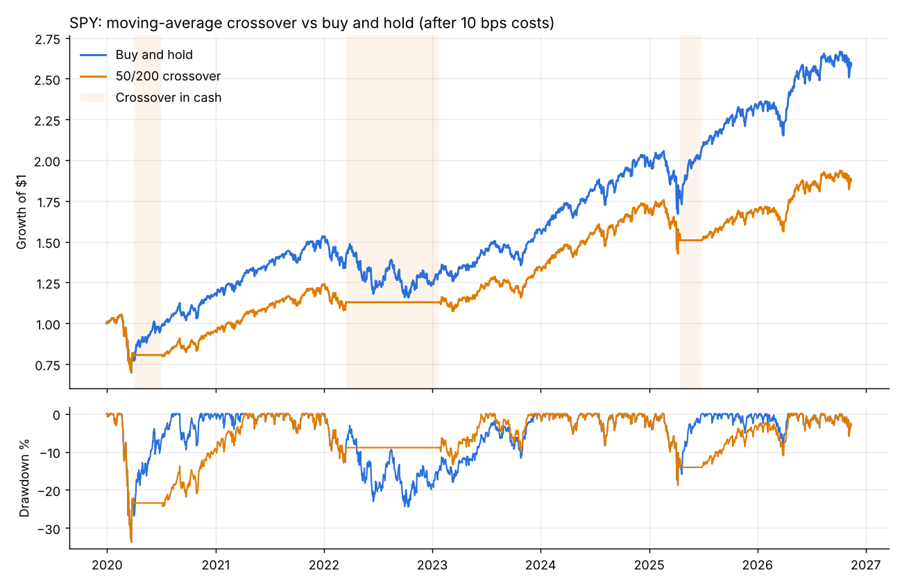

# Moving-average crossover vs buy and hold

_Generated by `scripts/ma_crossover.py` from data built 2026-11-14T02:35+00:00. Test period 30 Dec 2019 to 13 Nov 2026 (6.9 years). Costs 10 bps per unit traded. How it works and how to read it: [`docs/ma-crossover.md`](../docs/ma-crossover.md)._

**Rule:** hold SPY while its 50-day average price is above its 200-day average, otherwise hold cash (earning 0%). Signal at today's close, trade at today's close, earn from tomorrow.

## 1. SPY

| | CAGR | Volatility | Sharpe | Max drawdown | Growth of $1 | Time invested | Trades | Costs / yr |
| --- | --- | --- | --- | --- | --- | --- | --- | --- |
| Buy and hold | +14.8% | 20.0% | 0.79 | -33.7% | 2.58 | 100% | 0 | 0.01% |
| 50/200 crossover | +9.6% | 16.8% | 0.63 | -33.7% | 1.87 | 81% | 6 | 0.10% |

### Year by year

| Year | Buy and hold | Crossover | Difference | Days in cash |
| --- | --- | --- | --- | --- |
| 2019 | +0.1% | +0.1% | +0.0% | 1 |
| 2020 | +18.3% | -4.4% | -22.7% | 66 |
| 2021 | +28.7% | +28.7% | +0.0% | 0 |
| 2022 | -18.2% | -8.4% | +9.8% | 200 |
| 2023 | +26.2% | +19.1% | -7.1% | 17 |
| 2024 | +24.9% | +24.9% | +0.0% | 0 |
| 2025 | +17.7% | +0.1% | -17.6% | 49 |
| 2026 | +11.5% | +11.5% | +0.0% | 0 |

## 2. How fragile is it? Costs and timing

| Setting | Crossover CAGR | Crossover Sharpe | Buy-and-hold CAGR |
| --- | --- | --- | --- |
| 0 bps, trade same close | +9.7% | 0.64 | +14.8% |
| 5 bps, trade same close | +9.6% | 0.63 | +14.8% |
| 10 bps, trade same close | +9.6% | 0.63 | +14.8% |
| 25 bps, trade same close | +9.4% | 0.62 | +14.8% |
| 50 bps, trade same close | +9.1% | 0.60 | +14.8% |
| 10 bps, trade one day later | +9.1% | 0.60 | +14.8% |

## 3. Did we just pick lucky numbers? Every fast/slow pair

Sharpe ratio after costs for each pair (buy and hold: **0.79**). Same test period for every cell.

| fast \ slow | 100 | 150 | 200 | 250 |
| --- | --- | --- | --- | --- |
| 10 | 0.92 | 0.75 | 0.81 | 0.75 |
| 20 | 0.70 | 0.62 | 0.61 | 0.55 |
| 50 | 0.37 | 0.60 | 0.63 | 0.73 |
| 100 |  | 0.62 | 0.67 | 0.72 |

## 4. Same rule on 16 single stocks

Each stock tested on its own, same period and costs. These 16 are famous *today*, which flatters buy and hold (survivorship bias), so treat this as a stress test of the rule, not a forecast.

| Stock | B&H CAGR | Crossover CAGR | B&H Sharpe | Crossover Sharpe | B&H max DD | Crossover max DD | Trades |
| --- | --- | --- | --- | --- | --- | --- | --- |
| AAPL | +26.7% | +15.2% | 0.92 | 0.66 | -33% | -31% | 8 |
| MSFT | +20.1% | +14.9% | 0.76 | 0.70 | -37% | -28% | 8 |
| NVDA | +62.7% | +58.4% | 1.20 | 1.23 | -66% | -38% | 4 |
| AMZN | +16.7% | +8.9% | 0.61 | 0.44 | -56% | -43% | 9 |
| GOOGL | +24.3% | +20.3% | 0.83 | 0.81 | -44% | -31% | 7 |
| META | +18.3% | +17.2% | 0.60 | 0.67 | -77% | -40% | 8 |
| TSLA | +47.1% | +26.8% | 0.92 | 0.71 | -74% | -65% | 11 |
| NFLX | +10.0% | +21.3% | 0.44 | 0.75 | -76% | -48% | 6 |
| JPM | +17.4% | +12.6% | 0.68 | 0.61 | -44% | -44% | 6 |
| DIS | -2.3% | -3.5% | 0.09 | -0.10 | -61% | -53% | 12 |
| BA | -8.9% | -4.9% | 0.04 | -0.10 | -72% | -56% | 12 |
| GME | +51.0% | +38.6% | 0.89 | 0.76 | -88% | -88% | 13 |
| AMD | +43.2% | +41.1% | 0.91 | 0.95 | -65% | -39% | 6 |
| PFE | +1.5% | -1.5% | 0.19 | 0.01 | -59% | -38% | 15 |
| NKE | -11.9% | -6.1% | -0.17 | -0.22 | -79% | -47% | 11 |
| INTC | +1.8% | +8.8% | 0.31 | 0.41 | -71% | -63% | 6 |

The crossover had a higher Sharpe on **5 of 16** stocks and a smaller worst drawdown on **15 of 16**.
